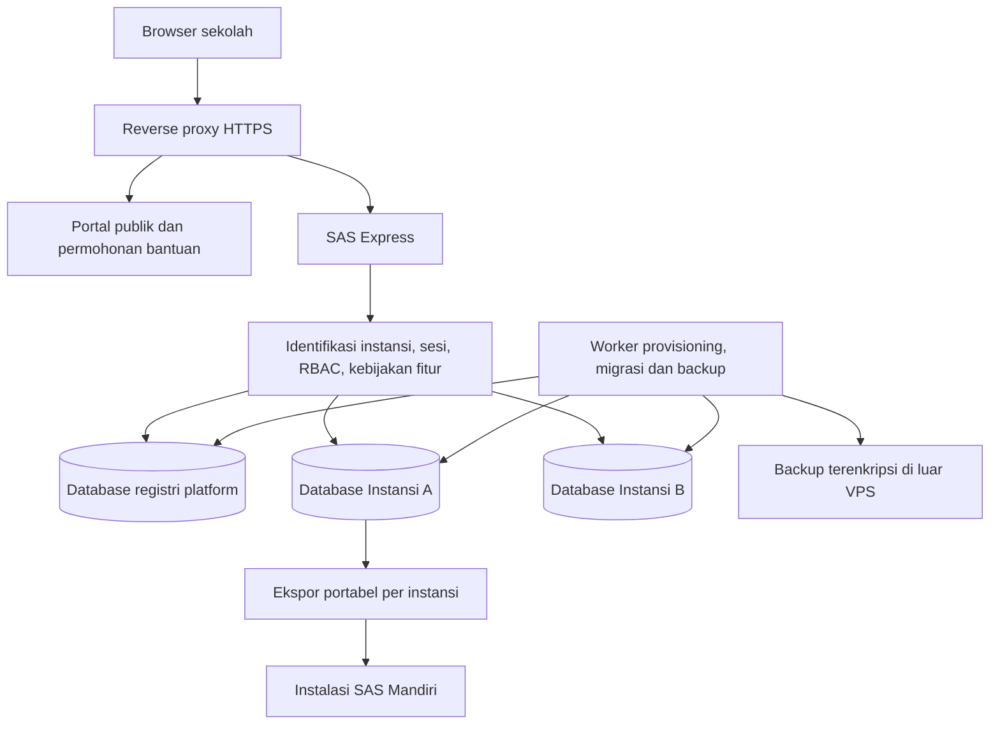

# Arsitektur SAS Bersama dan SAS Mandiri

Status: rancangan teknis, belum diimplementasikan. Dasar keputusan produk: [KONSEP-LAYANAN.md](KONSEP-LAYANAN.md). Satu repositori dan satu alur rilis; pembatasan layanan bersama merupakan kebijakan hosting, bukan penghapusan fitur dari kode MIT.

## Keputusan utama

Gunakan monolit Express modular dengan **aplikasi bersama dan satu database per instansi**. Instansi adalah pemilik pembukuan: sekolah mandiri atau yayasan. Layanan bersama membatasi satu unit per instansi; instalasi mandiri dapat memiliki beberapa unit dalam satu instansi. Jangan menyamakan `unit_id` dengan batas antarinstansi.



Database registri menyimpan identitas/slug instansi, status provisioning, referensi rahasia koneksi, versi skema, kebijakan fitur dan kuota, serta permintaan bantuan. Database ini tidak menjadi gudang laporan keuangan seluruh sekolah.

Database instansi menyimpan pengguna lokal, sesi, master, jurnal dan audit keuangan instansi itu. Pada rilis awal, pengguna yang membantu dua sekolah memiliki akun/sesi terpisah di masing-masing instansi. Login sekolah selalu memiliki konteks slug. SSO lintas instansi bukan prasyarat pilot.

## Dua mode distribusi

Usulan konfigurasi baru:

```dotenv
# Nama variabel berikut adalah rancangan, belum dikenali kode saat ini.
DEPLOYMENT_MODE=standalone
# Pada layanan bersama: DEPLOYMENT_MODE=hosted
# PLATFORM_DATABASE_URL dan referensi secrets hanya pada host layanan bersama.
```

Default distribusi open source adalah `standalone` dengan seluruh kapabilitas aplikasi aktif. Mode `hosted` memuat kebijakan `community-v1`. Frontend memperoleh kapabilitas efektif dari API; perubahan melalui DevTools, body permintaan, query, atau localStorage tidak boleh mengubah mode server.

Usulan capability: `cash.basic`, `journal.core`, `billing.basic`, `reports.basic`, `period.close`, `audit.read`, `data.export`, `data.import`, `bank.reconcile`, `budget.manage`, `tax.manage`, `ckpn.automatic`, dan `organization.multiunit`. `data.import` untuk restore paket hanya tersedia pada instalasi mandiri dan jalur provisioning internal; impor CSV siswa menggunakan capability terpisah `students.import`.

Izin efektif adalah irisan **kapabilitas deployment × izin peran × cakupan instansi/unit × status instansi**. Admin sekolah tetap tunduk pada kebijakan deployment. Admin platform merupakan akun terpisah dan tidak otomatis menjadi bendahara sekolah.

Kebijakan fitur harus mengenali dependensi. Misalnya `billing.basic` tidak boleh mematikan proses pengakuan pendapatan yang diperlukan oleh tagihan. Penonaktifan suatu capability tidak boleh menghilangkan laporan/histori yang sudah terbentuk.

## Alur permintaan dan isolasi

1. Resolver mencocokkan slug/host dengan registri tepercaya. Instansi tidak dikenal atau belum siap ditolak; tidak boleh jatuh ke koneksi default.
2. Resolver mengambil referensi rahasia koneksi dari konfigurasi server dan membuat konteks request yang tidak bisa ditimpa payload pengguna.
3. Session store memakai database instansi tersebut. Namespace/path cookie mengikat sesi ke slug, dengan `HttpOnly`, `Secure` di HTTPS, dan `SameSite`; server tetap memvalidasi instansi pada sesi.
4. Autentikasi mengambil pengguna dari database terpilih, lalu memeriksa status akun, RBAC, dan kapabilitas endpoint.
5. Service keuangan memakai koneksi pada konteks request; seluruh transaksi tetap menggunakan satu client PostgreSQL yang sama.
6. Log operasional mencantumkan ID instansi dan request; audit bisnis masuk ke database instansi. Hindari mencatat password, token, atau isi dokumen keuangan pada log platform.

Slug adalah alamat, bukan bukti otorisasi. Sekolah A tidak dapat memilih database B dengan mengganti parameter. Database dipisahkan dengan role PostgreSQL runtime yang berbeda; tiap role hanya mendapat hak pada DB/schema sendiri. Hak `CONNECT`, privilege `PUBLIC`, dan default privileges perlu dikonfigurasi eksplisit, bukan mengandalkan nama database saja. Koneksi PostgreSQL hanya melalui jaringan internal.

Pemilihan pool memakai `AsyncLocalStorage` atau konteks eksplisit. Pool dibatasi ukurannya, memiliki idle eviction, dan jumlah koneksi total dibatasi lintas instansi. Tidak membuat pool maksimal 12 koneksi untuk setiap sekolah tanpa batas. Pengujian paralel harus membuktikan tidak ada konteks yang bocor ketika koneksi digunakan ulang.

Pemisahan database memperkecil risiko query tanpa filter tenant dan mempermudah restore per instansi. Ini bukan isolasi fisik: CPU, disk, proses aplikasi, dan server PostgreSQL tetap berbagi sumber daya. Aplikasi yang dikompromikan masih berisiko terhadap semua rahasia yang dapat diaksesnya; pembaruan, pembatasan hak dan pemisahan akun operasi tetap diperlukan.

## Provisioning, migrasi dan bootstrap

Status instansi: `pending_review → provisioning → active`; status tambahan `read_only`, `maintenance`, `migration_failed`, dan `archived`. Kegagalan provisioning tidak boleh membuat sekolah bisa login ke database setengah jadi.

Worker provisioning memakai role khusus untuk membuat database/role. Role itu tidak digunakan oleh proses web untuk permintaan harian. Simpan referensi rahasia di registri, sementara nilai rahasianya berada dalam secret store atau berkas privat server yang tidak dipublikasikan.

Alur worker: validasi permohonan → reservasi slug unik → buat DB/role → jalankan migrasi → isi template master tanpa transaksi → terbitkan undangan → tandai aktif. Job memiliki kunci idempotensi dan dapat dilanjutkan setelah gagal; retry tidak melakukan TRUNCATE database yang sudah ada. Pembatasan 1 unit/3 pengguna ditegakkan secara atomik agar permintaan paralel tidak melampaui kuota.

Migrasi memakai versi skema yang dicatat per database. Uji dahulu pada salinan, backup sebelum perubahan, proses bertahap, dan catat kegagalan per instansi. Registri harus mengetahui versi yang kompatibel dengan aplikasi. Pemulihan memakai backup/prosedur yang sudah diuji; jangan berasumsi semua perubahan skema dapat di-rollback otomatis. Instansi yang gagal migrasi tidak boleh diarahkan ke DB instansi lain.

Bootstrap produksi berbeda dari `src/db/seed.js` sekarang yang memuat transaksi fiktif. Jalur hosted maupun standalone produksi yang baru harus menggunakan template master dan undangan admin; seed demo tetap menjadi perintah eksplisit untuk belajar.

## Batas API yang direncanakan

| Area | Contoh endpoint rancangan | Pengaman |
| --- | --- | --- |
| Publik | `POST /api/registrations`, `POST /api/install-requests` | Validasi, rate limit, verifikasi email |
| Platform | `GET /platform/api/tenants`, `POST /platform/api/tenants/:id/approve` | Admin platform terpisah, MFA, audit |
| Sekolah | `/s/:slug/api/auth/*`, `/s/:slug/api/journals/*` dan modul lain | Resolver, sesi instansi, RBAC |
| Kebijakan | `GET /s/:slug/api/capabilities` | Hanya izin efektif, tanpa secret |
| Portabilitas | `POST /s/:slug/api/exports`, `GET /s/:slug/api/exports/:id/download` | Admin instansi, kepemilikan job, masa berlaku |
| Impor mandiri | `POST /api/imports/validate`, `POST /api/imports/apply` | Mode standalone, DB baru, admin/CLI terotorisasi |

Nama endpoint belum merupakan API yang tersedia. Setiap endpoint modul dibungkus pemeriksaan capability pada server; endpoint sensitif juga memerlukan izin aksi, bukan sekadar status login. Pekerjaan latar belakang melakukan pemeriksaan identitas instansi dan kepemilikan job yang sama.

Status `read_only` tetap mengizinkan login, laporan dan ekspor oleh pengguna berwenang. Permintaan menulis ditolak dengan alasan yang jelas. Transisi ke baca-saja harus menunggu transaksi berjalan selesai dan memblokir penulis baru, termasuk worker, supaya ekspor final konsisten.

## Portabilitas dan bantuan instalasi

Ekspor berupa paket data bisnis dengan manifest versi format/skema, checksum, jumlah record, rentang data dan ringkasan pembanding. Seluruh ekspor diambil dari snapshot transaksi yang konsisten. Paket dibatasi ke satu instansi dan tidak memuat kredensial runtime, sesi, token atau hash sandi. Penandatanganan paket dan validasi asal dapat ditambahkan tanpa menjadikan kunci platform syarat membaca data sekolah sendiri.

Impor memvalidasi ukuran, struktur, checksum, kompatibilitas skema, referensi antarrecord, keseimbangan jurnal, neraca saldo, posisi piutang, saldo rekening, serta status periode. Tolak path traversal dan data yang mencoba menulis ke luar folder kerja jika memakai arsip. Impor dilakukan transaksional pada database baru dan menghasilkan laporan perbandingan. Gagal validasi berarti tidak melakukan cutover.

Alur cutover: snapshot latihan → uji restore → jadwal pembekuan tulis → paket final → impor → cocokkan laporan → persetujuan sekolah → undang ulang pengguna → aktifkan penulisan di server mandiri. Jadikan layanan asal baca-saja selama masa transisi. Perpindahan fitur dari shared ke standalone ditentukan konfigurasi deployment, bukan nominal kontribusi atau license key berbayar.

Panel permintaan instalasi hanya menyimpan kebutuhan dan status pekerjaan (`new`, `reviewed`, `scheduled`, `in_progress`, `handover`, `closed`). Kontribusi sukarela dicatat terpisah bila diperlukan. Jangan memakai tiket dukungan untuk menyimpan SSH key, password sekolah, atau akses permanen teknisi.

## Infrastruktur awal dan operasi

Mulai dengan satu VPS khusus SAS: reverse proxy HTTPS, aplikasi web, worker dengan concurrency kecil, dan PostgreSQL melalui Compose. Antrean ringan dapat memakai tabel job PostgreSQL terlebih dahulu. Redis/object storage tambahan tidak wajib pada pilot. Backup berada di server/bucket terpisah dengan enkripsi dan kunci yang dibatasi aksesnya.

Ukuran VPS diputuskan berdasarkan jumlah pengguna serentak, ukuran DB dan waktu laporan pada uji beban; jumlah sekolah saja tidak cukup. Satu VPS masih menjadi titik kegagalan bersama. Ketika hasil pengukuran membutuhkannya, pindahkan database ke server terpisah, tambah instance aplikasi, dan gunakan pooler koneksi. Perubahan ini tidak mengubah kepemilikan database per instansi.

Worker menerapkan kuota job per instansi, timeout laporan, batas impor/ekspor, dan pembagian giliran agar satu sekolah tidak menghabiskan kapasitas. Backup otomatis dipindahkan dari startup setiap proses web ke scheduler terpusat agar penambahan replica tidak menggandakan pekerjaan.

Target backup harian, retensi 30 hari, RPO 24 jam dan RTO 8 jam berasal dari usulan produk. Ukur dengan latihan restore satu sekolah dan simulasi kehilangan VPS. Pantau health DB, latensi/error aplikasi, koneksi aktif, penggunaan disk, keberhasilan backup, umur job dan log dukungan. Definisikan siapa yang menerima peringatan dan menjalankan pemulihan sebelum pembukaan publik.

## Peta perubahan terhadap kode sekarang

| Kode saat ini | Perubahan yang diperlukan |
| --- | --- |
| `src/config.js` | Mode deployment dan konfigurasi platform; identitas instansi dari DB saat hosted |
| `src/db/index.js` | Pemilihan pool berbasis konteks, transaksi terikat tenant, tanpa fallback hosted |
| `src/auth.js`, `src/sessionStore.js` | Identitas/sesi lokal instansi; akun platform terpisah |
| `src/db/initialize.js`, `seed.js` | Bootstrap produksi tanpa demo; runner migrasi per database |
| `server.js` | Mount rute dengan konteks slug dan middleware capability |
| `src/routes/*`, `src/services/*` | Pemeriksaan peran/aksi, capability, kuota dan konteks worker |
| `src/services/backupService.js` | Backup per instansi, scheduler worker, retensi dan akses unduh |
| `public/app.js`, `branding.js` | Identitas dinamis, alur slug, menu sesuai capability, ajakan mandiri |
| Modul baru | Registri, provisioning, undangan, ekspor/impor, permintaan instalasi |

Perhatian khusus: query laporan sekarang mengasumsikan satu database organisasi; `unit=all` berarti semua unit pada database itu. Pertahankan arti ini hanya di dalam instansi. Endpoint laporan dan backup yang ada juga perlu ditinjau izin aksinya; tidak cukup sekadar menambahkan menu tersembunyi atau memilih DB.

## Gerbang kelulusan sebelum data sekolah riil

1. Dua instansi dengan email/ID record yang sama tetap terisolasi ketika request berjalan bersamaan, sesi tertukar, slug diganti, dan pool didaur ulang.
2. Penolakan akses diuji pada API langsung: admin sekolah tidak dapat mengaktifkan fitur hosted, melampaui kuota, atau membaca data/backup/job instansi lain.
3. Bootstrap tanpa demo, persetujuan, undangan kedaluwarsa, reset password dan penangguhan akun bekerja; autentikasi dilindungi rate limit, CSRF untuk sesi, dan konfigurasi HTTPS.
4. Seluruh tes akuntansi lama lulus; tes tambahan membuktikan mode hosted tidak menghilangkan pengakuan pendapatan, audit, tutup buku dan koreksi yang diperlukan.
5. Backup dan ekspor berhasil dipulihkan ke instalasi mandiri baru, dengan keseimbangan jurnal, laporan, histori audit dan piutang cocok; tidak ada rahasia/data instansi lain di paket.
6. Cutover tidak mengizinkan transaksi baru di sumber sesudah pembekuan; job yang berjalan mematuhi batas yang sama.
7. Uji beban memberi dasar kuota pilot; simulasi kegagalan worker/DB, migrasi parsial, kehilangan VPS dan restore tercatat.

## Dasar referensi

Model aplikasi bersama dengan database terpisah adalah pilihan desain untuk kondisi SAS ini, bukan persyaratan semua layanan sekolah. Pertukaran isolasi, pengelolaan migrasi, pemulihan dan biaya dibahas pada [Microsoft Azure Architecture Center: storage and data for multitenant solutions](https://learn.microsoft.com/en-us/azure/architecture/guide/multitenant/approaches/storage-data).

Jika kelak mempertimbangkan database bersama dengan `tenant_id`, perlu rancangan ulang constraint, query dan kebijakan akses. PostgreSQL mendukung RLS, tetapi pemilik tabel/superuser dapat melewatinya dan operasi seperti TRUNCATE tidak tunduk pada RLS; jangan menganggap penambahan kolom tenant sudah memberikan isolasi. Lihat [PostgreSQL Row Security Policies](https://www.postgresql.org/docs/current/ddl-rowsecurity.html).
